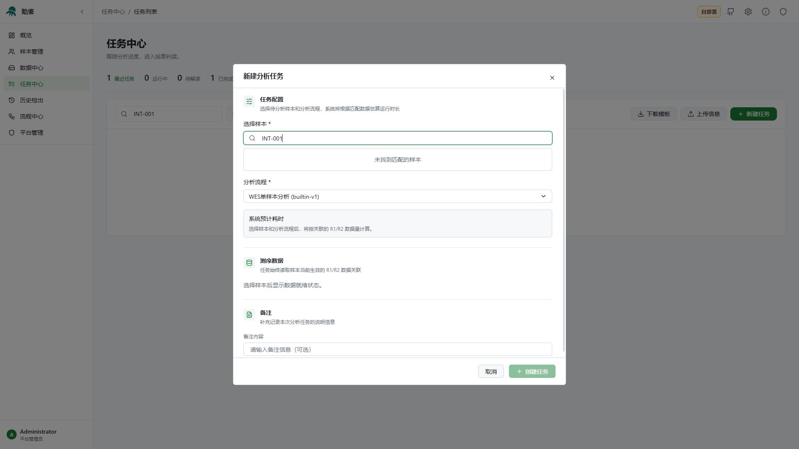

# YiJian 自部署版使用说明

本文介绍平台部署完成后的日常使用：登记样本、准备测序数据、创建分析任务、查看结果，以及解读和生成报告。安装与启动服务请参阅[自部署指引](self-hosted-deployment.md)。

下文以简体中文界面为例，所有编号和路径示例均为示意。不同流程支持的分析项目，以实际配置和任务产出为准。

## 目录

- [第一次使用](#1-第一次使用)
- [完成一次分析的操作顺序](#2-完成一次分析的操作顺序)
- [样本管理](#3-样本管理)
- [数据中心](#4-数据中心)
- [流程与分析资源](#5-流程与分析资源)
- [创建和管理分析任务](#6-创建和管理分析任务)
- [查看和解读分析结果](#7-查看和解读分析结果)
- [报告和文件下载](#8-报告和文件下载)
- [历史检出](#9-历史检出)
- [管理员：创建账号与分配权限](#10-管理员创建账号与分配权限)
- [常见问题](#11-常见问题)

## 1. 第一次使用

向部署管理员获取平台网址、账号和密码，用桌面浏览器打开平台。阅读登录页的隐私政策后，输入账号信息并登录。自行注册的账号如提示等待审核，需要由平台管理员批准。

登录后，先确认页眉显示“自部署”。左侧导航提供以下入口；侧栏收起时，可点击左上角标志展开。

| 入口 | 用途 |
| --- | --- |
| 概览 | 查看样本数量、任务状态和待处理事项 |
| 样本管理 | 登记样本、补充表型、关联测序数据、维护家系 |
| 数据中心 | 上传测序文件，或登记已经复制到服务器的文件 |
| 任务中心 | 创建任务、查看进度、处理失败和进入解读 |
| 历史检出 | 查询实例内已有的历史检出记录 |
| 流程中心 | 查看流程，管理基因列表、BED、CNV 基线和报告服务 |
| 平台管理 | 管理账号与授权，仅平台管理员可访问 |

个人设置入口位于页眉或左下角用户菜单，可调整语言等个人偏好。

### 账号和数据范围

自部署版的业务数据在同一个实例内共享。普通用户可以查看、查询和下载实例内的业务数据；创建、修改、上传等操作需要管理员授权。账号凭据和个人界面偏好不因此共享。

平台管理员拥有全部权限。普通用户默认没有业务写权限，能打开页面并不代表能提交修改。按钮禁用并提示“无此操作权限，请联系平台管理员授权”时，请联系管理员，不需要反复登录。

## 2. 完成一次分析的操作顺序

1. 在“样本管理”登记样本，确定内部编号。
2. 在“数据中心”上传 R1/R2，或登记服务器上已经存在的文件。
3. 检查样本是否已经关联正确的 R1/R2。
4. 进入“任务中心”，点击表格右上方的“新建任务”，在弹窗中选择样本和分析流程，再点击“创建任务”。
5. 查看运行进度，等待分析和结果导入完成。
6. 进入解读，查看质控、筛选变异、核对 IGV 并保存解读。
7. 根据需要生成报告、下载结果，最后标记“解读完成”。

也可以先准备数据再录入样本。两边的内部编号一致时，平台会尝试自动匹配；无论先后顺序如何，提交分析前都应检查最终关联结果。

## 3. 样本管理

### 3.1 新建样本

进入“样本管理 → 样本列表”，点击表格右上方的“新建样本”。

填写内部编号、性别、样本类型等信息；按需要补充批次、临床诊断、HPO 表型和备注，然后保存。

| 编号 | 含义 | 使用方式 |
| --- | --- | --- |
| 内部编号 | 使用者为样本确定的编号，如 `INT-001` | 用于识别样本和匹配测序数据，录入前先确定，避免重复 |
| 样本编号 | 平台生成的样本显示编号 | 在列表和样本详情中查看 |
| UUID | 平台生成的资源唯一标识 | 用于精确引用样本或文件；不要自行编造 |

HPO 表型应通过搜索框选择相应术语。补充准确的表型有助于后续证据整理；批量样本模板不包含 HPO，导入后可在样本详情或编辑窗口继续补充。

### 3.2 批量导入样本

1. 在样本列表点击“下载模板”，获得 XLSX 文件。
2. 保留六列表头，删除或替换模板中的示例数据，每行填写一个样本。
3. 点击“批量导入”，选择填写好的 XLSX。
4. 检查校验提示，修正有问题的行后重新选择文件。
5. 点击“开始导入 / 重试失败行”，查看每行的导入结果。

| 模板列 | 填写说明 |
| --- | --- |
| 样本编号 | 仅作参考，导入时由系统生成，不能用这一列指定编号 |
| 内部编号 | 必填，同一文件中不能重复，不能超过 100 字符 |
| 性别 | 填写“男”“女”或“未知”；留空按未知处理 |
| 样本类型 | 全血、唾液、DNA、组织或其他；留空按其他处理 |
| 批次 | 可选，不超过 100 字符 |
| 临床诊断 | 可选，用于记录研究背景或诊断描述 |

每次最多导入 **1,000 行、2 MB**。已有内部编号会报错，不会覆盖已有样本。在同一个导入窗口中重试时，已经成功的行会被跳过。

### 3.3 检查和调整测序数据关联

在样本列表或详情中检查测序数据匹配状态。需要手动指定时，打开数据关联窗口，分别选择 Read1 和 Read2，再保存。

确认两个文件属于同一份样本、双端方向正确，而且文件状态可用。自动匹配没有成功时，先检查样本与数据的内部编号是否一致，以及数据是否已完成上传或登记。

解除关联只表示取消样本与文件之间的对应关系，不等同于删除测序文件。样本信息的修改、删除和数据关联操作均需要“样本管理写入”权限。

### 3.4 家系分析前的准备

需要进行父母与先证者分析时：

1. 先分别登记先证者、父亲和母亲的样本，并关联各自的 R1/R2。
2. 进入“样本管理 → 家系管理”，创建或编辑家系。
3. 添加成员，设置先证者和父母关系，并把成员关联到对应样本。
4. 在任务中心下载批量任务模板，填写家系 ID 和家系流程 ID，通过“上传信息”预览并创建任务；一次只填写一个家系也可以。

只有成员关系正确、所需成员已关联样本的家系，才能用于相应家系分析。具体数据是否齐全，还需检查各样本的测序数据状态。

## 4. 数据中心

数据中心有两种准备测序数据的方式。浏览器上传会传输测序文件；“批量信息上传”只登记服务器上已有的文件，不会重新上传文件内容。

### 4.1 通过浏览器上传

1. 点击“上传数据”，选择本机的测序文件。
2. 按窗口要求设置或确认内部编号、Read1/Read2 等信息。
3. 开始上传，等待文件变为可用状态。
4. 回到样本管理，检查文件关联是否正确。

上传过程中可根据界面提供的操作重试、取消或隐藏上传记录。“隐藏到数据中心”是收起当前上传界面，后续进度到数据中心查看；它不等于取消上传。关闭页面或浏览器可能影响仍在进行的文件传输，离开前应确认状态。

### 4.2 登记已经复制到服务器的文件

适合测序文件较大，或数据已经在部署服务器上的情况。此入口适用于自部署本地存储；是否显示、允许登记到哪个目录，取决于管理员的存储配置。

操作前需要同时具备“数据中心上传与管理”和“样本管理写入”权限，因为登记时内部编号还会参与样本匹配。

1. 请管理员将文件完整复制到配置的数据目录，并确认 Octopus 容器可以读取。
2. 在数据中心点击“下载模板”，获得三列的 XLSX。
3. 每行填写一个内部编号及其 R1/R2 路径。
4. 点击“批量信息上传”，选择 XLSX。
5. 点击“校验并登记 / 重试失败行”，保持窗口打开，等待校验完成。
6. 成功后查看数据中心和样本匹配结果；失败行根据提示修正后再试。

| 内部编号 | read1的绝对路径 | read2的绝对路径 |
| --- | --- | --- |
| INT-001 | /data/uploads/INT-001_R1.fastq.gz | /data/uploads/INT-001_R2.fastq.gz |

**路径必须是容器内可见的 Linux 绝对路径。** 例如，管理员把宿主机 `/srv/sequencing` 挂载到容器的 `/data/uploads`，模板就应填写 `/data/uploads/...`，而不是 `/srv/sequencing/...`。实际可用目录以登记窗口显示为准；文件必须位于配置的数据目录内。

平台会完整读取文件，检查文件大小、gzip 完整性、FASTQ 记录结构、序列与质量长度，以及双端记录数和 read ID 是否对应；通过后为两个文件分别生成 UUID，并记录校验信息。登记不会再复制一份测序文件。

注意以下几点：

- 只把文件复制到服务器，不会让它自动出现在数据中心；需要完成信息登记。
- 每次最多 **1,000 行、2 MB**；R1/R2 不能指向同一文件，表内路径不能重复。
- 已登记路径不会被覆盖，也不会重新分配 UUID。
- 大文件校验需要时间，应先完成复制，再登记；校验期间不要修改或移动文件。
- 批次可能部分成功。查看每行状态，重试失败行，避免重复提交成功项。
- 结构校验通过不代表平台知道这份数据是否包含原始交付的全部 reads；需要核对交付完整性时，还应比对提供方的校验值或记录数。

### 4.3 日常维护

通过内部编号和文件名查找数据，核对 Read 方向、大小和状态。修改内部编号后，应再次确认样本关联。

已经登记或被任务引用的文件，不要直接在服务器上改名、移动或覆盖。删除前应确认没有正在使用这些文件的任务，并阅读删除确认提示。

## 5. 流程与分析资源

初次分析可先使用管理员已经验证过的流程。要调整 BED、基线或建立特定分析方案，再维护流程中心的资源。

### 5.1 流程列表与流程 ID

进入“流程中心 → 流程列表”，查看流程名称、**流程 ID**、参考基因组、版本、BED 和 CNV 基线。

流程 ID 用于批量任务的信息表。填写时复制列表中的 ID，不要使用流程名称或版本号代替。例如，`builtin-v1` 是版本显示值，不是流程 ID。

内置流程和内置资源有维护限制。需要自定义方案时，使用页面提供的新建流程入口，选择基础流程，再配置可用的 BED、基线等资源。保存后记录新流程的 ID，供后续任务使用。

### 5.2 基因列表

进入“流程中心 → 基因列表”，创建或编辑关注的基因集合，检查内容后发布。解读时可按基因列表筛选变异。

基因列表管理权限控制创建、编辑、发布和删除；浏览、选择已有可用列表不需要这项写权限。筛选只改变当前查看范围，不会重新执行分析或删除其他结果。

### 5.3 BED 文件

进入“流程中心 → BED 文件”，上传目标区域文件，选择对应的参考基因组并等待校验。确认状态可用后，再在自定义流程或基线校准中选择。

BED、参考序列和 CNV 基线的版本应一致，不要把 hg19 与 hg38 资源混用。校验失败时按提示修正文件后重试；内置 BED 的维护限制仍然适用。

### 5.4 CNV 基线

进入“流程中心 → 基线管理”，可查看基线及其 **ID**。需要建立自定义基线时，使用校准入口，填写名称，选择参考基因组、配对测序数据和对应 BED，然后启动校准。

等待任务完成且基线可用，再将其配置到流程。CNV 基线校准产出的是分析资源，不是普通变异解读结果，不应通过普通任务的解读页查看。

基线任务权限独立于普通任务管理权限；只有普通任务权限不代表可以创建或管理基线任务。

## 6. 创建和管理分析任务

### 6.1 通过任务中心新建单个任务

新建任务统一从任务中心的弹窗操作：

- 从左侧导航进入“任务中心”，点击表格右上方的“新建任务”。
- 在概览页点击“新建任务”，会先跳转到任务中心；到达后，再点击表格右上方的“新建任务”打开弹窗。

打开弹窗后：

1. 搜索并选择待分析样本。
2. 选择单样本分析流程，核对参考基因组和流程版本。
3. 检查“测序数据”中的准备状态，确认样本已关联正确的 R1/R2。
4. 按需要填写备注，查看预计耗时。
5. 确认后点击“创建任务”。

截图使用虚构编号演示搜索；未选择样本时，“创建任务”按钮不可用。家系任务和需要逐项指定 CNV、SV 开关的任务，可使用下述“上传信息”方式创建。

预计耗时用于安排工作，不是完成时间承诺，实际耗时还受数据量、服务器负载和存储速度影响。

### 6.2 批量创建任务

任务中心提供“下载模板”和“上传信息”两个按钮：

1. 点击“下载模板”，使用下载的 XLSX，不要更改工作表“批量任务”和必需表头。
2. 按行填写样本或家系、流程 ID 和选项。
3. 点击“上传信息”，选择文件并查看预览。
4. 修正所有无效行，再次上传。
5. 确认预览中的样本、流程及任务数量后，点击确认创建。

| 模板列 | 填写说明 |
| --- | --- |
| 样本ID | 单样本任务使用的样本标识；可用值按模板说明填写，可使用样本 UUID 或可解析的内部编号 |
| 家系ID | 家系流程填写对应家系 ID；不要用成员样本 ID 代替 |
| 流程ID | 从流程列表复制，不能填流程名称或版本号 |
| 任务备注 | 可选 |
| 启用CNV | 是/否、TRUE/FALSE 或 1/0；留空默认启用 |
| 启用SV | 是/否、TRUE/FALSE 或 1/0；留空默认关闭 |

每次最多 **100 个任务、2 MB**。单样本与家系列按所选流程填写，不要在同一行同时指定两类对象。上传信息仅用于校验和预览，确认创建后才会产生任务；提交后以逐行返回的创建结果为准，避免重复提交已经成功的行。

### 6.3 查看状态与运行详情

任务列表可以搜索任务、查看状态和进度。打开任务详情中的运行信息，查看步骤、日志和失败原因。

| 状态或阶段 | 应如何处理 |
| --- | --- |
| 等待数据 | 回到样本管理，检查所需 R1/R2 及家系成员的数据关联 |
| 排队中 | 等待调度，或使用页面提供的启动操作 |
| 运行中 | 查看当前步骤与日志；确需中断时使用“取消” |
| 分析完成、结果处理中 | 等待归档与结果导入；此时暂时不能解读不一定是分析失败 |
| 分析失败或已取消 | 阅读错误原因，修正问题后再使用“重试” |
| 可解读 | 进入结果页查看总览和变异 |

百分比暂时不变不等于任务停滞。比对、变异检测等步骤可能长时间运行，应结合日志更新时间、步骤状态和管理员看到的实际进程判断。

### 6.4 区分两种重试

**分析失败后的“重试”**会重新提交工作流。先修正参考文件、输入数据、流程参数或资源不足等原因，再执行。是否复用已经完成步骤，由服务器的 MiniWDL 缓存配置和输入一致性决定；点击重试不保证所有步骤都能复用。

**分析完成但结果导入失败**时，先查看任务运行详情中的导入提示。确认归档已完成，并修正导入问题后，使用“重新导入结果”；这与重新运行分析不同，不需要为了修复导入直接重跑整个任务。

## 7. 查看和解读分析结果

在任务中心找到可解读的任务，点击“解读”。结果页主要包含“总览”“变异解读”和“文件”。

### 7.1 先检查总览和质控

查看本次执行对应的样本或家系、参考基因组、质控指标和结果概况。先确认数据与任务对象一致，再开展变异筛选。

分析完成不等于质控合格。覆盖度、测序质量和其他指标应按本单位验证过的标准评价。

### 7.2 按类型筛选变异

进入“变异解读”，根据需要切换：

| 分类 | 内容 |
| --- | --- |
| SNP / InDel | 单核苷酸和小片段插入缺失变异 |
| CNV(Region) | 区域级拷贝数变异 |
| CNV(Exon) | 外显子相关拷贝数变异 |
| 动态突变 | 重复扩增相关结果 |
| MEI | 移动元件插入相关结果 |
| 线粒体 | 线粒体变异结果 |
| UPD | 单亲二体相关结果 |
| ROH | 纯合区结果 |

实际显示的数据取决于流程产出。某分类没有结果，不能据此认定该类分析已经执行且结果为阴性；还应核对流程配置和运行记录。

使用搜索、列筛选、排序和基因列表逐步缩小范围。筛选后找不到记录时，先清除不再需要的筛选条件，确认当前分类和参考版本。

### 7.3 查看详情、标记和保存解读

打开变异详情，核对注释、基因、频率、已有证据及家系信息。按需要添加关注标记、复核状态和解读内容，并使用对应的保存操作。

页面中的自动评估用于辅助整理候选和证据，不能替代人工复核。初次加载可能需要下载结果并在浏览器中计算，请等待评估完成；如取消初评，已有结果和已保存的解读仍可查看。

“证据更新”或重新评估提示表示评估上下文有变化。重新评估前先确认已保存的工作，不要把评估变化误认为重新运行了分析。

AI 辅助入口只有在部署者配置了相应服务且账号获授权时才能使用。调用前应了解该实例使用的模型服务及其数据处理方式；生成内容仍需人工核对。

### 7.4 使用 IGV 核对测序证据

点击支持查看测序证据的坐标入口，打开 IGV。

1. 确认定位区间与目标变异一致。
2. 查看参考序列及可用的 BAM、VCF、BED 等轨迹。
3. 根据需要缩放或移动区间，检查 reads 和周边证据。
4. 回到解读详情，记录复核结果。

IGV 依赖本次任务的 BAM 与索引，以及管理员配置的对应 FASTA 与 FAI。只有注释表并不能显示原始 reads；缺少或不可读的文件需要管理员处理。平台在满足条件时会保存渲染截图，截图不能替代完整的 BAM 证据。

### 7.5 完成或重新打开解读

确认需要保留的解读和标记均已保存后，点击“解读完成”。完成后结果进入只读状态，减少误修改。

需要继续调整时，具备权限的用户可使用“重新打开解读”，完成修改后再次标记完成。普通只读账号不能通过重新打开获得写权限。

## 8. 报告和文件下载

### 8.1 配置报告服务

具备“报告服务配置”权限的用户可进入“流程中心 → 报告服务”，填写服务名称、服务地址和认证密钥，测试连接后保存并启用。

报告生成依赖部署者提供的外部报告服务，并非填写名称后平台就能自动生成任意格式的报告。接口要求和填写示例可在配置窗口查看。密钥保存后不会以明文回显；编辑时按界面说明保留或更新。

### 8.2 生成和下载报告

进入任务的“文件”页，在右侧报告生成区域选择已经启用的报告服务，确认当前标记和解读内容后，点击“生成并下载”。该操作需要“结果解读与报告生成”权限，生成记录显示在该区域下方。

平台会准备本次生成所用的解读快照，并显示生成记录。失败时查看具体提示；若远端结果状态不确定，先核实生成记录和报告服务状态，避免连续重复提交。

### 8.3 下载已有结果

在“文件”页左侧的归档下载区域，按可用项目下载归档结果或结果包。下载既有文件不需要业务写权限，但文件必须仍在实例中且可读取。

自部署本地存储可点击“准备结果 ZIP”，等待打包完成后下载；BAM、索引和归档结果也可从文件列表单独下载。结果 ZIP 不包含 BAM 和原始测序数据。此入口直接使用当前实例的归档文件，不需要进行费用报价或领取付费链接。

下载内容以当前页面说明为准。不要将筛选表格、分析原始文件和最终报告视为同一种产物。自部署的数据保留和备份由部署者管理，不应套用其他服务的保留期限。

## 9. 历史检出

进入“历史检出”，按照页面提供的查询条件查找已有记录，需要进一步核实时返回来源任务。

历史记录用于对照已有检出和解读，不能代替当前任务的数据、参考版本和证据复核。实例内多人共享数据时，修改关注和解读可能影响其他使用者看到的业务记录，协作前应约定操作分工。

## 10. 管理员：创建账号与分配权限

进入“平台管理”，创建账号或审核注册申请。新建用户时填写显示名称、邮箱、初始密码和角色；密码需要符合界面给出的要求。

为普通用户逐项勾选业务权限，可使用“全选/清空”。编辑已有账号时检查当前授权后保存；账户列表会显示授权数量。管理员拥有全部权限，不通过取消勾选来削减权限。

| 权限 | 允许的操作 |
| --- | --- |
| 样本管理写入 | 维护样本、家系、项目分组及文件匹配 |
| 数据中心上传与管理 | 上传和管理测序文件，包括服务器文件登记 |
| 普通任务管理 | 创建、启动、取消、重试、修改和删除普通任务，以及结果导入重试 |
| 流程管理 | 创建、修改、启停和删除自定义流程，配置流程参数 |
| 基因列表管理 | 创建、编辑、发布和删除基因列表 |
| BED 文件管理 | 上传、校验、修改、重试和删除 BED |
| 基线任务管理 | 创建和管理 CNV 基线任务 |
| 报告服务配置 | 维护、测试和启停报告服务 |
| 结果解读与报告生成 | 保存解读、标记和复核、截图、AI 辅助及报告生成 |

各项权限独立；一项操作涉及多个领域时，需要同时具备相应权限。例如，服务器文件登记还参与样本匹配，需要同时授予数据和样本权限。

撤权对后续请求生效，不会主动停止已经运行的分析。用户不需要重新登录才能应用新授权，必要时刷新页面。平台管理员不能删除自己的账号。

## 11. 常见问题

| 现象 | 先检查什么 |
| --- | --- |
| 按钮是灰色的 | 查看悬停提示；可能是缺少权限、信息未填齐、资源状态不可用或解读已经锁定 |
| 文件复制到服务器后看不到 | 是否已经通过“批量信息上传”完成登记；仅复制文件不会自动入库 |
| 提示路径不存在或不可读 | XLSX 是否填写容器内路径，挂载是否正确，文件是否在允许目录中且服务可读取 |
| 提示文件变化或校验失败 | 是否仍在复制文件，gzip/FASTQ 是否完整，R1/R2 是否配对，校验时是否被修改 |
| 有数据但样本显示未匹配 | 内部编号是否一致，文件是否可用，Read1/Read2 是否正确；必要时手动关联 |
| 流程或基线 ID 无效 | 是否复制了 ID 列，是否误填名称或版本，资源是否属于当前实例且处于可用状态 |
| 任务长时间显示同一百分比 | 先看运行步骤和日志，联系管理员核对进程和资源，不要仅凭百分比取消任务 |
| 分析失败 | 先记录失败步骤和错误信息，排除输入、参考文件和资源问题，再重试 |
| 分析完成但不能解读 | 检查归档和结果导入状态；导入失败使用“重新导入结果”，不要直接重跑分析 |
| 评估数据读取失败 | 刷新页面，检查登录和网络；仍失败时将任务 UUID、分类和错误交给管理员 |
| IGV 无法打开 | 核对参考版本，检查 BAM/BAI、FASTA/FAI 和容器读取权限；记录具体轨迹错误 |
| 没有可选的报告服务 | 请有权限的用户配置并启用报告服务，检查连接测试结果 |
| 更新平台后仍显示旧错误 | 强制刷新页面，再重新进入任务；不要先删除数据或重复创建任务 |

反馈问题时提供任务 UUID、操作入口、出错时间和错误提示即可。截图前检查是否包含账号密钥或不应公开的样本信息。

## VCF 起始的 SNP/InDel 注释

在数据中心上传或导入一个 VCF 文件，然后新建任务，选择业务样本、VCF 注释流程（hg19 或 hg38）和 VCF 文件。单样本自动选择；多样本须填写 VCF 头中的准确样本名，一次只分析一个样本。无需 FASTQ、BED 或 CNV 基线。组织也可基于内置 VCF 流程建立自己的流程。

完成后在 SNP/InDel 页面解读、关注和生成现有报告，下载规范化 VCF、注释文件、统计与性别推算说明。不显示未执行的 QC 或其他变异模块。自部署不扣积分，SaaS 与 WES 一样按计算时间结算。详见 [VCF2Anno 接入说明](vcf2anno-integration.md)。
